# 二维规划与控制：从自行车模型到 RRT* + Pure Pursuit

[English](README.md)

[结果](#结果) · [实验发现](#发现) · [本地运行](#怎么运行)

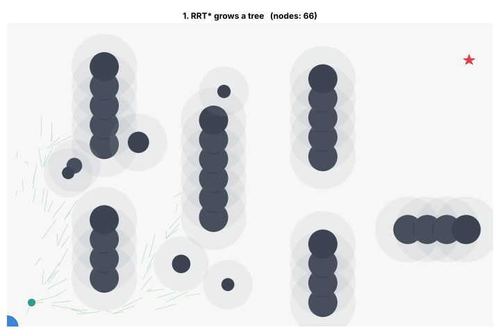

这是一个我从零写的二维自动驾驶小仿真，只用了 NumPy 和 Matplotlib。车先用 RRT* 绕开障碍物规划出一条路线，再闭环开过去：转向用 Pure Pursuit，车速用 PI 控制，车本身是运动学自行车模型。每个函数都配了 pytest 测试（一共 30 个）。

这里的算法都不是新的。A*、RRT、RRT*、Pure Pursuit 和 PID 都是经典算法，也早就有现成的库。我想做的是每一个都自己写一遍，把它们连成一个闭环，再用实验看每一部分在哪里会出问题。我学到的东西大多来自这些实验，所以这份 README 大部分在讲实验。

## 整体流程

```
地图 + 障碍物
  -> 把障碍物按安全余量放大（1.5 米）
  -> RRT* 找路线（按线段检查碰撞）
  -> 拉直（互相看得见的点之间直接连）+ 每 0.2 米重新取点
  -> 每 0.1 秒：PI 控车速 + Pure Pursuit 控转向 -> 自行车模型走一步
  -> 记录横向误差、用时、车身有没有撞到东西
```

我分了七关来做，每一关都建立在上一关上：

| 关卡 | 做了什么 | 文件 |
|---|---|---|
| 1 | 画出世界：圆形障碍物和碰撞检测 | `geometry.py` |
| 2 | 运动学自行车模型，调用一次走一步 | `bicycle.py` |
| 3 | P / PI / PD 控制器 | `control.py` |
| 4 | Pure Pursuit 跟路线 | `pure_pursuit.py` |
| 5 | 格子地图上的 A* | `astar.py` |
| 6 | RRT，然后 RRT* | `rrt.py` |
| 7 | 全部组装起来，跑三个场景并统计 | `path_utils.py`、`simulate.py`、`scenarios.py` |

## 结果

三个场景，巡航速度 5 m/s，车身当作半径 0.9 米的圆：

| 场景 | 路线长 (m) | 用时 (s) | 平均横向误差 (m) | 最大横向误差 (m) | 到达 | 碰撞 |
|---|---:|---:|---:|---:|:---:|:---:|
| 窄道 | 30.5 | 6.8 | 0.10 | 0.31 | 是 | 否 |
| U 弯 | 43.2 | 9.5 | 0.27 | 1.60 | 是 | 否 |
| 随机障碍 | 36.2 | 7.9 | 0.14 | 0.46 | 是 | 否 |

| 窄道 | U 弯 | 随机障碍 |
|---|---|---|
| 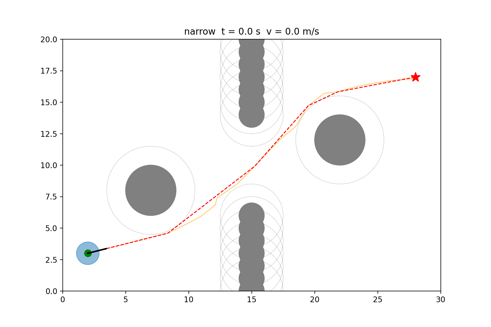 | 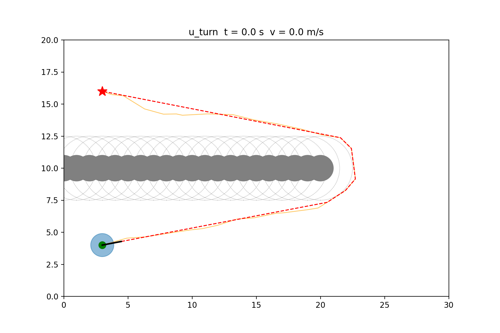 | 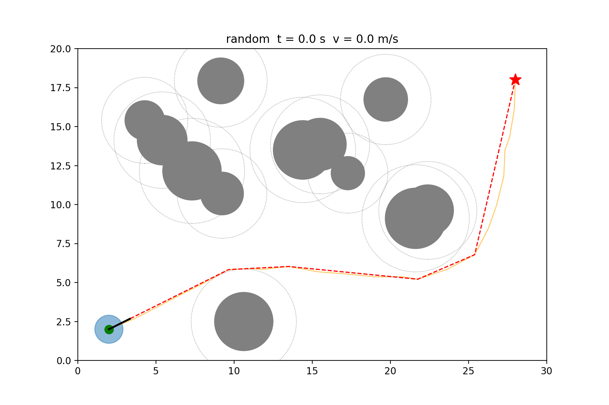 |

U 弯的最大误差是其他场景的好几倍，这是整个项目里最有意思的结果（发现 1）。

## 发现

### 发现 1：U 弯的路线车根本开不出来

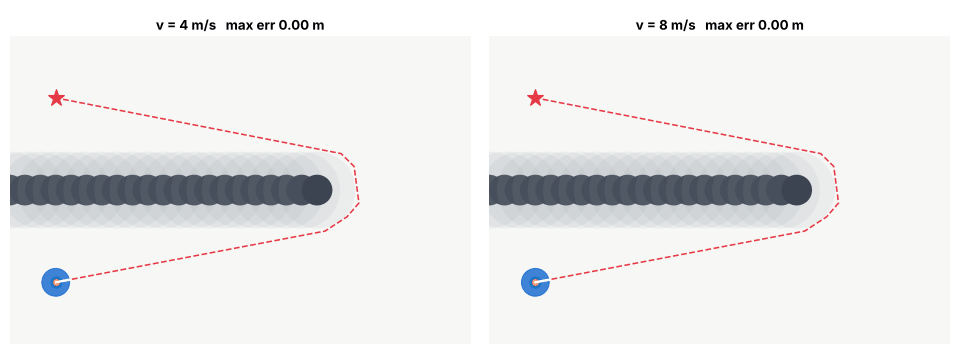

我一开始以为是车太快了，就把速度降下来。结果 4 m/s 时最大误差还是 1.64 米，和 5 m/s 时差不多；8 m/s 时直接撞墙。

真正的原因是几何。我把前轮转角限制在 ±35°，轴距 2.5 米，所以车能开出的最小圆半径是 2.5 / tan 35° ≈ 3.6 米。RRT* 只认识点和直线，它在墙的尽头给出的转弯比这个急得多。车物理上转不过来的弯，控制器再好也跟不上，开慢也不会让转弯半径变小。

要真正解决这个问题，规划器必须知道车是怎么动的。Hybrid A* 这类考虑运动学的规划器做的就是这件事，这也是我接下来想试的方向。

### 发现 2：跟得准不等于安全

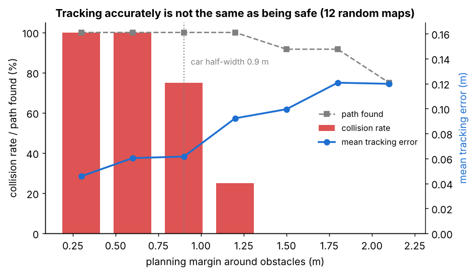

规划前我会把每个障碍物都放大一圈余量。每种余量我跑了 12 张随机地图。余量很小时（0.3 和 0.6 米），路线紧贴着障碍物，跟踪误差最小（约 0.05 米），但车在每一张地图上都会撞。车身从中心到边缘有 0.9 米，余量比这个小，控制器跟得再准也不安全。余量 1.5 米时一次都没撞。再往大调，路线变长、误差稍大；到 2.1 米时有些缝隙被堵死，12 张图里只有 9 张能找到路线。

所以我用 1.5 米：0.9 米车身半宽，加 0.6 米留给 Pure Pursuit 抄近道切掉的弯角。

### 发现 3：预瞄距离要跟着车速变

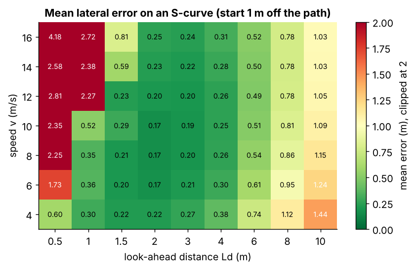

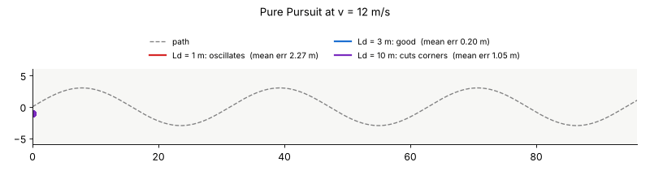

Pure Pursuit 每一步都朝路线上前方 Ld 米的点打方向。12 m/s 时，Ld = 1 米会过冲、原地转圈（平均误差 2.27 米）；Ld = 10 米每个弯都抄近道（1.05 米）；Ld = 3 米效果很好（0.20 米）。热图里绿色的好区域随着车速变高往右移，所以最后的控制器用 Ld = max(2, 0.8 · v)，而不是一个固定数。

### 发现 4：RRT* 会越来越好，RRT 停在第一条路线

| RRT 和 RRT*（同一张图、同一个随机种子） | 路线长度随迭代次数的变化 |
|---|---|
| 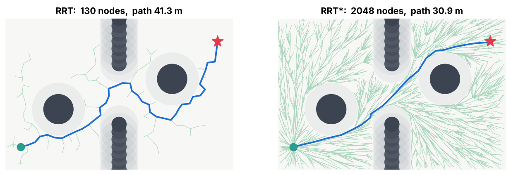 | 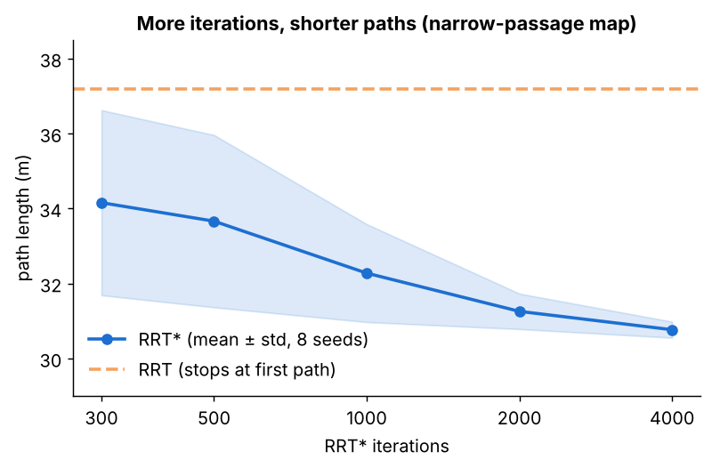 |

RRT 一碰到终点就停，路线就是随机树碰巧长出来的样子，弯弯绕绕。RRT* 对每个新点多做两件事：选一个让总代价最小的父节点；如果附近的点改从新点走更近，就把它们重新连线。在窄道地图上（8 个随机种子），RRT 平均 37.2 米；RRT* 300 次迭代后是 34.2 米，4000 次后是 30.8 米，而且不同种子之间的差距小了很多。

这里我还发现了一个问题：一开始我只检查新点在不在障碍物里，没检查连过去的那条线。这样路线可能直接从障碍物边上穿过去。现在所有检查都沿整条线段每 0.1 米取一个点。

### 发现 5：格子上的 A* 和 RRT*

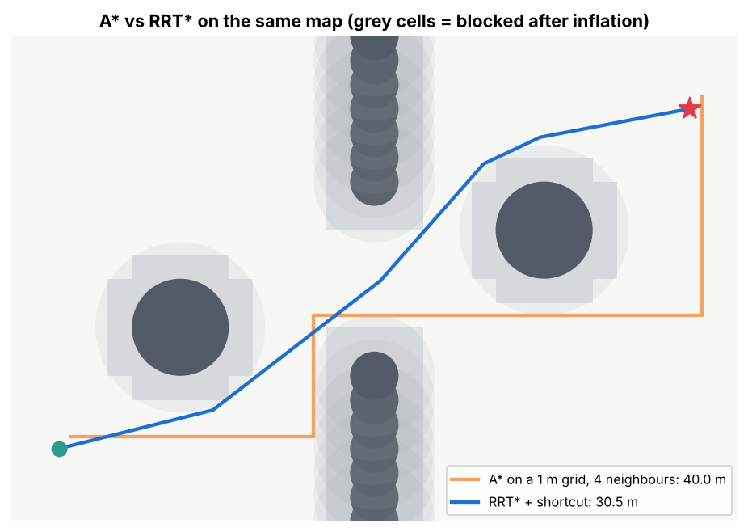

同一张图上，1 米格子、四邻居的 A* 走了 40.0 米。它保证是*格子上*最短的路线，但只能上下左右走，所以会走出台阶和 90° 直角弯。RRT* 加拉直是 30.5 米，可以斜着走。A* 精确、每次结果一样；RRT* 在连续空间里找、带随机性。两者各有擅长的地方。

### 发现 6：车速控制，P → PI → PD

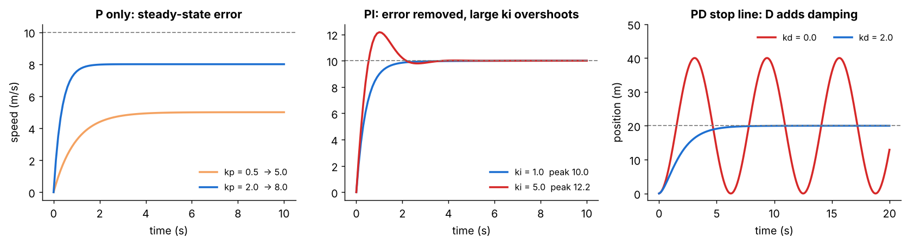

车速模型是 `v += (a - drag · v) · dt`，目标 10 m/s。

- **只用 P** 永远到不了目标：kp = 0.5 停在 5 m/s，kp = 2 停在 8 m/s。稳定时油门 `kp · 误差` 正好抵消阻力，所以总要留一点误差。kp = 20 时系统发散：每一步误差都乘上 `1 - (kp + drag) · dt`，这个数一旦跑出 (-1, 1) 就会越来越大。这就是我控制课上讲的离散系统单位圆。
- **PI** 消掉了误差。ki = 1 稳在 10 m/s、没有超调；ki = 5 更快，但超调到 12.2。
- **D** 对车速控制没有帮助。在这个一阶模型里，加 D 反而让超调变大了一点（12.2 → 12.6）。D 在二阶问题里才有用：停在前方 20 米的停止线（通过加速度控制位置）。没有 D（kd = 0）时车在 0 到 40 米之间一直来回晃；kd = 2 时稳稳停在 20 米。

所以最后的车速控制用 PI。

## 怎么运行

演示使用程序生成的地图，不需要下载数据集、模型权重，也不需要 GPU。所有命令都在项目根目录运行。

### 安装环境

创建 Python 3 虚拟环境并安装依赖（NumPy、Matplotlib、导出 GIF 用的 Pillow，以及 pytest）：

```bash
git clone https://github.com/asiansumer/2d-planning-control.git
cd 2d-planning-control
python3 -m venv .venv
source .venv/bin/activate  # macOS / Linux
python -m pip install -r requirements.txt
```

Windows PowerShell 使用 `.venv\Scripts\Activate.ps1` 激活环境。之后运行 `deactivate` 即可退出虚拟环境。

### 测试和演示

跑测试（30 个）：

```bash
python -m pytest -q
```

跑三个场景，会打印结果表，并保存 `results/{narrow,u_turn,random}.png/.gif`：

```bash
python -m scripts.run_scenarios
```

生成这份 README 里的所有图（大约 2 分钟）。后面加名字可以只生成其中几张：`hero uturn lookahead margin convergence pid astar`。

```bash
python -m scripts.make_figures
python -m scripts.make_figures pid
```

没有图形界面的服务器可在绘图命令前加 `MPLBACKEND=Agg`，例如 `MPLBACKEND=Agg python -m scripts.run_scenarios`。

## 项目结构

```
geometry.py       碰撞检测、线段检测、障碍物放大、角度
bicycle.py        运动学自行车模型
control.py        P / PI / PD
pure_pursuit.py   朝预瞄点打方向
astar.py          格子 A*
rrt.py            RRT 和 RRT*
path_utils.py     路线长度、拉直、重新取点、横向误差
simulate.py       闭环仿真和统计
scenarios.py      三个测试地图 + 规划流程
scripts/          每关一个脚本，加上 run_scenarios 和 make_figures
tests/            每个模块的 pytest 测试
results/          图和动图
```

## 局限和下一步

- **规划器不考虑车怎么转弯。** 这就是 U 弯问题的原因。下一步：Hybrid A* 或 Reeds-Shepp 曲线，让规划出的每条路线都开得出来。
- **巡航速度是固定的。** 车应该在急弯前减速。简单的做法是按路线曲率设目标车速。
- **车是一个圆，障碍物不会动。** 真实的规划器用车的矩形外形，还要预测移动的物体。
- **纯 Python 比较慢。** 一张图上 4000 次迭代的 RRT* 大约要 1.5 秒，因为找最近点是一个普通循环。我打算在这个仓库里用 C++ 重写 A* 或 RRT*，比较速度。
- **只有运动学模型。** 没有轮胎侧滑，所以高速下的结果偏乐观。
